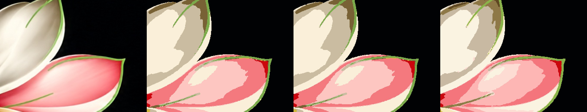
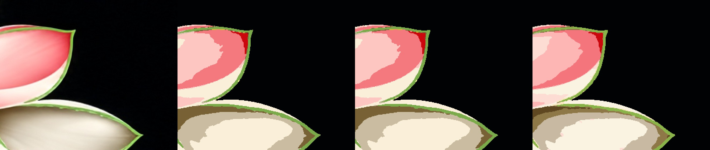
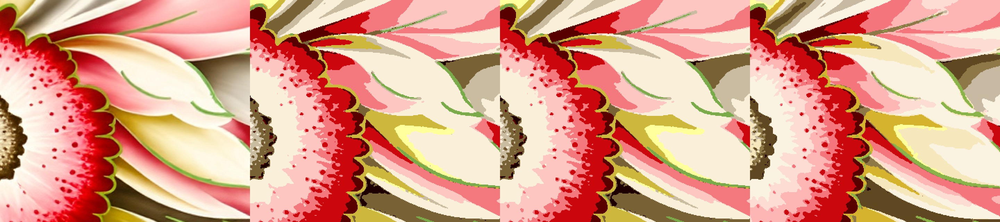

# Dhaari on design 13

A vein, hairline, or curved stripe is tagged on the source at full size, then kept through Reduce. The majority filter does not eat a tagged pixel. A crumb of 1–6 px that is not a vein, not an exact 1 px mark, and not part of a dotted cluster still joins the ink around it. Flat interiors are not retouched. No gradient or spray screen is added.

Design: `textile_project/tests/samples/design13_black_floral.jpg`, 3709×1695. Smoothing 0, separation cleanup 0. Strips are source, then the flat reduce.

## Full picture (proxy palette, then full-size assignment)

At 8 inks the palette is the same twelve colours as before, including the leaf green `#7BAA4A`. The tag plus the crumb merge moves 5,516 pixels (0.088%): veins stay, isolated specks fall from 5,426 to 4,713. Of the 74,757 source pixels that read as green, 98.14% stayed green before and 98.22% after. At 12 inks the count stays 15, specks fall from 8,641 to 7,532, and 6,991 pixels move. Stacking the plates rebuilds the flat image.

Source, 8 inks before, 8 inks after, 12 inks after:

The red stipple in the flower centre is a cluster of dots, not a stripe, and stays:

## Same flower, direct reduce

A window small enough to skip the proxy used to spend its eight inks on the flats and had no green screen. The curved green lines came out as the olive next to them. The vein pass adds `#9AB660` and paints only those pixels.

Source, before, after:

Numbers are in `metrics.json`.
