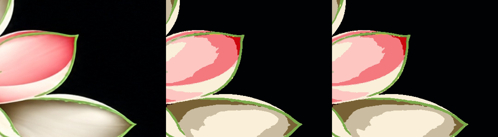
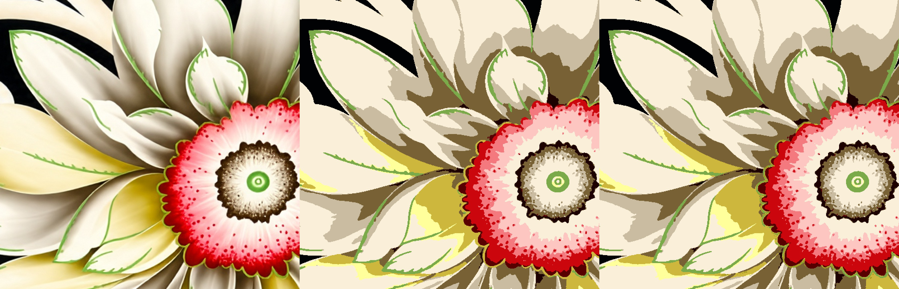

# Dhaari on design 13 — stronger, and sharp

What got stronger: a vein is a **hue spike**. Its a* or b* sits outside the colours on both sides, so a pink-to-cream shade step is not tagged. Faint olive still clears a lower distance from the local median. Pieces of the same vein become one ink.

What got sharper: the tagged core is trimmed to one width (bulges go, nothing is grown — no SDF fairing) and painted **one flat colour**. A warm fringe that is redder than it is green does not become a screen. A stipple cloud is not joined into a vein. Junk islands of 1–6 px still merge. No gradient or spray.

Design: `textile_project/tests/samples/design13_black_floral.jpg`, 3709×1695. Smoothing 0, separation cleanup 0.

## Full picture, 8 inks

Strips are source, the previous flat, this flat.

Leaf green `#7BAA4A` stays (2.04%). One small extra ink, `#A4991A` (0.13%). 18,819 pixels move (0.30%). Of 92,947 source pixels that read as green, 96.13% stayed green before and 96.06% after — the full-size path already had the green screen; the change is the stroke, not the count. Isolated specks are 4,713 before and 6,048 after (more thin marks are held, not merged). Plates rebuild the flat.

The red stipple stays a cluster of dots:

## Same flower, direct reduce

A 900×680 window that skips the proxy used to have no green screen. The curved lines came out as the olive beside them. This pass adds `#87B446` (0.98%) and paints only those pixels, as one hard stroke.

Source, before, after:

Numbers are in `metrics.json`.
